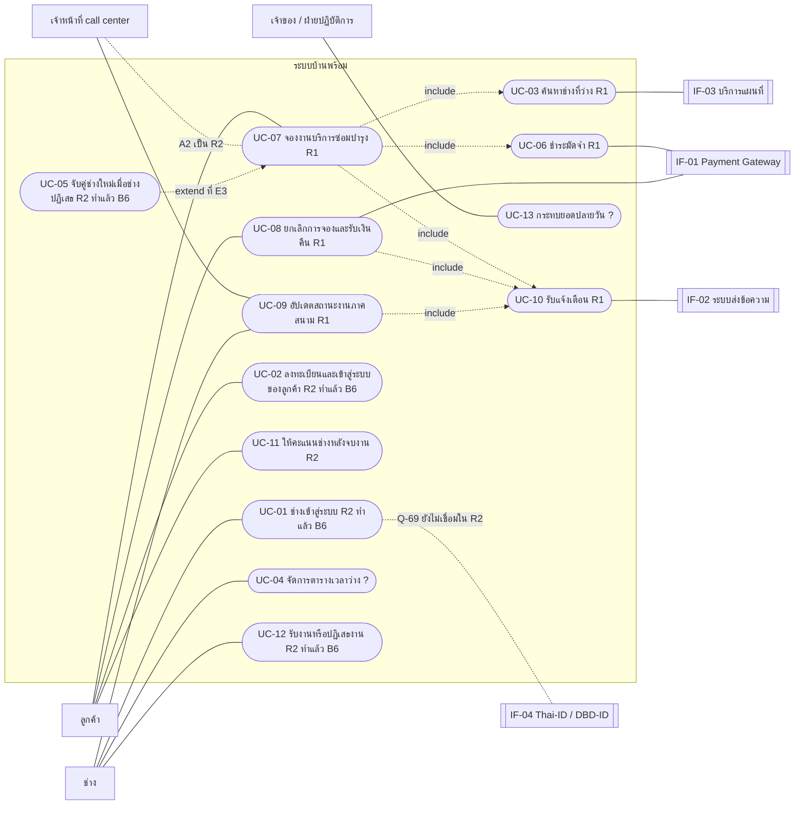
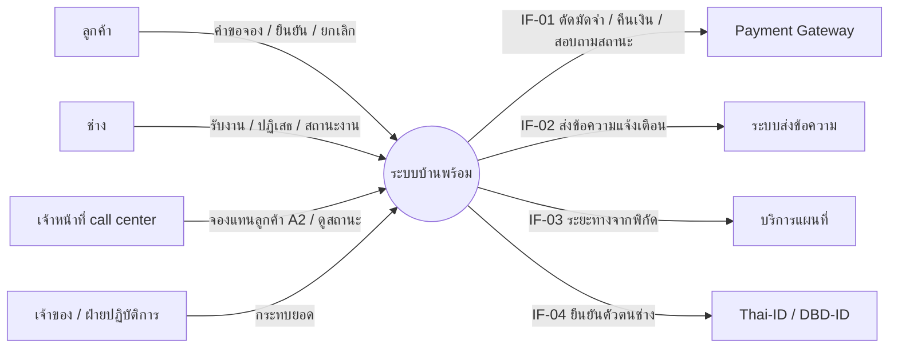
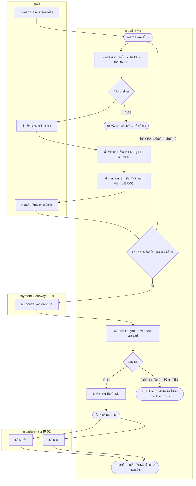
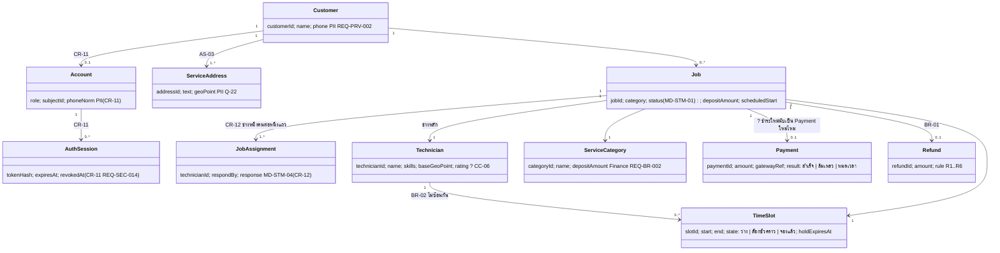
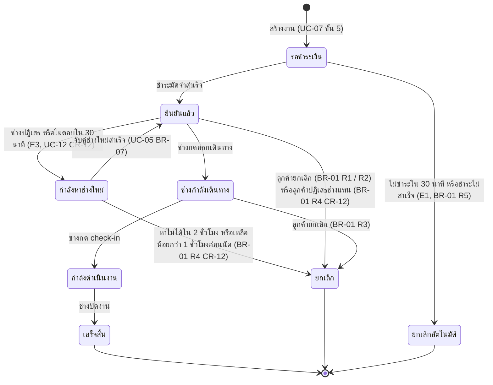
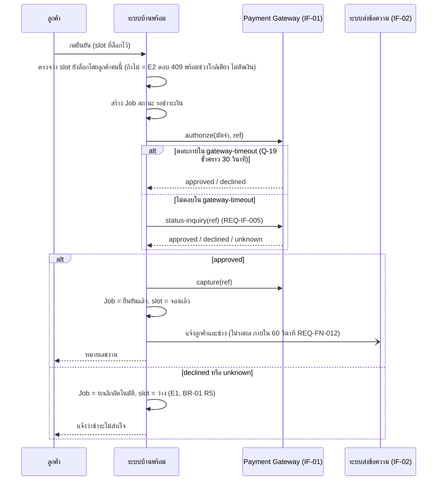

# Model Set | บ้านพร้อม (MD set v0.1)

รุ่น 0.1 (6 ก.ย. 2569) | เจ้าของ: กลุ่ม X | เขียนด้วย Mermaid เปิดดูภาพได้บน GitHub
มาจากบทเรียน: Integrated Requirements Modelling
ช่องที่ทำเครื่องหมาย ? คือคำถามที่โมเดลเปิดเผย ไม่ใช่ความผิดพลาด ทุกช่อง ? มีเจ้าของใน cc-log.md หรือ questions.md
ภาพต้นฉบับขนาดเต็มอยู่ในหน้าบทเรียน Modelling ไฟล์นี้คือฉบับข้อความที่ diff ได้

## 0. Model Plan (เลือกโมเดลตามคำถาม)

| คำถามที่ข้อความตอบไม่ได้ | มุมมอง | โมเดล | ระดับ | เหตุผล |
|---|---|---|---|---|
| ระบบมีเป้าหมายของผู้ใช้อะไรบ้าง อะไรอยู่ R1 | ภาพรวม | MD-UCD-01 | Working model | ต้องเห็นทั้งระบบก่อนเจาะ |
| ระบบคุยกับใครภายนอก ส่งรับอะไร | ภาพรวม และการเชื่อมต่อ | MD-CTX-01 | Baseline model | ทุกเส้นต้องมี REQ-IF |
| ใครทำอะไรก่อนหลังใน UC-07 ตัดสินใจตรงไหน | กระบวนการ | MD-ACT-07 | Working model | UC-07 เสี่ยงที่สุด (เงิน ระบบภายนอกสองตัว ข้อยกเว้นมาก) |
| ลูกค้ามีบ้านหลายหลังได้ไหม งานหนึ่งมีช่างกี่คน | ข้อมูล | MD-DOM-01 และ data-dictionary.md | Working model | คำถามเชิงโครงสร้างข้อมูล |
| งานหนึ่งเปลี่ยนสถานะได้กี่แบบ อะไรห้ามเกิด | สถานะ | MD-STM-01 และ State-Event Matrix | Baseline model | REQ-DAT-002 นับสถานะไม่ตรงกับ UC และ Gherkin |
| ถ้าระบบชำระเงินเงียบระหว่างจอง ใครรอ ใครปล่อยช่วงเวลา | การเชื่อมต่อ | MD-SEQ-07-05 และ Interface Contract IF-01 | Baseline model | มีเวลารอ และมีผลต่อเงินที่ย้อนกลับไม่ได้ |
| ข้อมูลส่วนบุคคลไหลไปไหน ใครเขียนใครอ่าน | ข้อมูล | DFD ระดับ 0 | Working model | ใช้ต่อในบทเรียนความปลอดภัย |

## 1. MD-UCD-01 Use Case Diagram ทั้งระบบ

วงรีแทนด้วยกล่องมุมโค้งของ Mermaid | R1 = รุ่นแรก | R2 = เลื่อน | ? = ยังไม่กำหนดรุ่น

กติกาที่ตรวจแล้ว: ทุก use case ชี้ไปหา REQ-FN อย่างน้อยหนึ่งข้อ หรือบันทึกว่ายังไม่มี (UC-04, UC-12, UC-13) | actor ตรงกับ stakeholders.md | ไม่มี generalization เพราะยังไม่มีหลักฐานว่ามีลูกค้าหรือช่างชนิดย่อย

ความครอบคลุม REQ-FN กับ UC

| REQ | UC |
|---|---|
| REQ-FN-008 | UC-07 (ขั้น 1 ถึง 6) |
| REQ-FN-041 | UC-07 (ขั้น 3 ถึง 5) |
| REQ-FN-012 | UC-07 ขั้น 6 ผ่าน UC-10 |
| REQ-FN-014 | UC-09 และ UC-10 (R1 ยังไม่ทำ เป็น Should) |
| REQ-FN-030 | ยังไม่มี UC รองรับ (Could) |

## 2. MD-CTX-01 Context Diagram ทั้งระบบ

call center อยู่นอกวงกลม เพราะเจ้าหน้าที่เป็นผู้ใช้ ไม่ใช่ส่วนหนึ่งของระบบ
เส้น IF-01 เสี่ยงที่สุด เพราะเกี่ยวกับเงินและมี timeout

| เส้น | ระบบภายนอก | ข้อมูล | ทิศทาง | REQ |
|---|---|---|---|---|
| IF-01 | Payment Gateway | ยอดมัดจำ reference ผลชำระ การคืนเงิน | สองทาง | REQ-IF-001, REQ-IF-005, REQ-IF-006 |
| IF-02 | ระบบส่งข้อความ | เบอร์โทร (PII) ข้อความ สถานะส่ง | สองทาง | REQ-IF-002, REQ-CMP-00x |
| IF-03 | บริการแผนที่ | พิกัดที่อยู่และจุดตั้งต้นช่าง ระยะทาง | สองทาง | BR-03 (ยังไม่มี REQ-IF ของตัวเอง) |
| IF-04 | Thai-ID / DBD-ID | คำขอและผลการยืนยันตัวตน | สองทาง | ยังไม่มี REQ-IF (UC-01 อยู่ R2) |

## 3. MD-SYS-01 System Overview (product perspective ไม่ระบุเทคโนโลยี)

| ส่วน | use case ที่ใช้ |
|---|---|
| แอปลูกค้า | UC-07, UC-08, UC-02, UC-11 |
| แอปช่าง | UC-09, UC-01, UC-04, UC-12 |
| คอนโซลเจ้าหน้าที่ | UC-07 A2, UC-09 (ดูสถานะ), UC-13 |
| แกนกลางบริการจองและงาน | ทุก use case |
| ที่เก็บข้อมูล | D1 ถึง D4 ในส่วน 9 |
| ระบบภายนอก | IF-01 ถึง IF-04 |

สถาปัตยกรรมที่ระบุเทคโนโลยีเป็นเรื่องของ plan.md ไม่ใช่ของสเปก

## 4. Process Overview แบบ To-Be ทั้งบริการ

ห้าลู่: ลูกค้า | call center | ระบบบ้านพร้อม | Payment Gateway | ช่าง

| ช่วง | รหัส UC | กฎและจุดเชื่อมต่อ | สถานะ MD-STM-01 ที่เกิด | รุ่น |
|---|---|---|---|---|
| 1 แจ้งงาน ค้นช่าง จอง | UC-07, UC-03, UC-06, UC-07 A2 | BR-01 (แสดงเงื่อนไข), BR-02, BR-03, IF-01 | รอชำระเงิน | R1 (A2 เป็น R2) |
| 2 ผลการชำระ และช่างรับงาน | UC-10, UC-12, UC-05 | BR-01 R5 และ R4, IF-02 | ยกเลิกอัตโนมัติ, ยืนยันแล้ว, กำลังหาช่างใหม่ | R1 (UC-05 เป็น R2) |
| 3 ยกเลิกและคืนมัดจำ | UC-08, UC-10 | BR-01 R1 R2 R4, BR-05, IF-01, IF-02 | ยกเลิก | R1 |
| 4 วันนัด | UC-09 | BR-04, BR-01 R3 (?) | ช่างกำลังเดินทาง, กำลังดำเนินงาน, เสร็จสิ้น | R1 (UC-11 นอกขอบเขต R1) |

ประเด็นที่การไล่ตรวจกับ MD-STM-01 เปิดเผย

- "ช่างรับงาน" ไม่เปลี่ยนสถานะ งานที่ช่างยังไม่ตอบกับงานที่ช่างรับแล้วอยู่สถานะ "ยืนยันแล้ว" เหมือนกัน ถ้าช่างไม่ตอบเลย งานค้างนานเท่าไร ? (ส่งให้ SH-01)
- "ลูกค้ายืนยัน" ตอนปิดงานเกิดที่ไหน ? (CR-10 Q-31: ไม่มีขั้นนี้ เสร็จสิ้นเมื่อช่างปิดงาน)
- UC-05 เคยมีสองชื่อ (จับคู่งานด่วน กับ จับคู่ช่างใหม่) แก้แล้วเป็นชื่อเดียว (CC-08)

## 5. MD-ACT-07 Activity Diagram ของ UC-07 (swimlane)

สามจุดที่ข้อความ UC ซ่อนไว้ และภาพเปิดเผย

- จุดตัดสินใจ "ช่วงเวลาถูกจองแล้ว" อยู่ในลู่ระบบ ระบบต้องตรวจก่อนส่งไปชำระ จึงได้ความต้องการใหม่ REQ-FN-041 ล็อกตั้งแต่ขั้น 3 ถึง 5 (นานเท่าไร ? เป็น Q-18 และ CC-02)
- fork "แจ้งทั้งสองฝ่าย" ถ้าแจ้งช่างสำเร็จแต่แจ้งลูกค้าไม่สำเร็จ ถือว่าขั้น 6 สำเร็จไหม ? UC ไม่ได้บอก
- ระหว่างขั้น 3 ถึง 5 ลูกค้าค้างหน้าจอได้นานเท่าไร ? ไม่มีใครกำหนด
- E3 (ช่างปฏิเสธหลังยืนยัน) เกิดหลังจบ use case ไปต่อที่ MD-STM-01 และ UC-05

REQ และ UC ที่อ้าง: UC-07 ทุกขั้น, REQ-FN-008, REQ-FN-041, REQ-FN-012, REQ-IF-001, BR-01, BR-02, BR-03

## 6. MD-DOM-01 Domain Model (conceptual ทั้งระบบ)

- งานหนึ่งมีช่างหลักหนึ่งคน (BR ชนิด Facts) จึงเป็น multiplicity 1 ฝั่ง Technician
- Job กับ Payment ยังตอบไม่ได้ ถ้าชำระล้มเหลวแล้วชำระใหม่ นับเป็น Payment ใหม่หรือแก้รายการเดิม ?
- ช่างเห็น Customer.phone ก่อนนัด 2 ชั่วโมง (REQ-SEC-004)
- นิยาม ค่า PII อายุการเก็บ และเจ้าของ อยู่ใน data-dictionary.md

## 7. MD-STM-01 วงจรชีวิตของงาน (8 สถานะ ตาม REQ-DAT-002 ที่แก้ CC-01 แล้ว)

CR-12 (B6): ลูกศรของ E3 สร้างจริงแล้ว (specs/007-accept-rematch) "ลูกค้าปฏิเสธช่างแทน" เดิมเขียนเป็นลูกศรออกจาก "กำลังหาช่างใหม่" แต่ลูกค้าเห็นช่างแทนได้หลังงานกลับเป็น "ยืนยันแล้ว" จึงย้ายไปเป็นลูกศรออกจาก "ยืนยันแล้ว" (BR-01 R4 ไม่เปลี่ยน) "รับงาน" ของช่างไม่ใช่สถานะของงาน ดู MD-STM-04 ใน specs/007-accept-rematch/models.md Q-50 ปิด (2 ชั่วโมง)
สถานะ "กำลังดำเนินงาน" และ "เสร็จสิ้น" ยกเลิกไม่ได้ (BR-01 R6) จึงไม่มี transition "ยกเลิก" ออกจากสองสถานะนี้
จาก "กำลังดำเนินงาน" ไปไหนได้อีกนอกจาก "เสร็จสิ้น" ยังไม่มีใครตอบ (ลูกค้าไม่อยู่บ้าน ช่างทำไม่เสร็จต้องนัดใหม่) ?

### State-Event Matrix

ทุกช่องต้องเขียนอะไรสักอย่าง ช่อง ? คือคำถามที่มีเจ้าของ (Q-48 ถึง Q-54 ใน questions.md)

| สถานะ / เหตุการณ์ | ชำระสำเร็จ | หมดเวลา 30 นาที | ลูกค้ายกเลิก | ช่างปฏิเสธ | ช่างกดออกเดินทาง | สถานะ offline มาถึงช้า (REQ-OP-002) |
|---|---|---|---|---|---|---|
| รอชำระเงิน | ไป ยืนยันแล้ว | ไป ยกเลิกอัตโนมัติ | ไป ยกเลิก คืน 0 เพราะยังไม่ตัดเงิน ? (Q-48) | ไม่เกี่ยว (ยังไม่แจ้งช่าง) | ห้าม ระบบต้องปฏิเสธ | ไม่เกี่ยว |
| ยืนยันแล้ว | ซ้ำ เพิกเฉย และบันทึก log | ไม่เกี่ยว | ไป ยกเลิก [BR-01 R1/R2] | ไป กำลังหาช่างใหม่ (E3) | ไป ช่างกำลังเดินทาง | ถ้า check-in มาถึงก่อน ออกเดินทาง ? (Q-49) |
| กำลังหาช่างใหม่ | ไม่เกี่ยว | หาไม่ได้ภายในกี่นาทีจึงคืนเงิน ? (Q-50) | ไป ยกเลิก [BR-01 R4 คืน 100%] | ไม่เกี่ยว | ห้าม | ไม่เกี่ยว |
| ช่างกำลังเดินทาง | ไม่เกี่ยว | ไม่เกี่ยว | ไป ยกเลิก [BR-01 R3 หักค่าเดินทาง CR-10] | ช่างยกเลิกกลางทาง ? (Q-51) | ซ้ำ เพิกเฉย | ยอมรับถ้า timestamp ต้นทางเรียงถูก |
| กำลังดำเนินงาน | ไม่เกี่ยว | ไม่เกี่ยว | BR-01 R6 บอกว่ายกเลิกไม่ได้ แต่หมายถึงหลังเสร็จ ? (Q-52) | ? (Q-53) | ห้าม | ? (Q-54) |
| เสร็จสิ้น | ไม่เกี่ยว | ไม่เกี่ยว | ปฏิเสธ แล้วไปกระบวนการร้องเรียน [R6] | ไม่เกี่ยว | ห้าม | เพิกเฉย และบันทึก log |

คอลัมน์สุดท้ายมาจาก REQ-OP-002 (หมวด Operational) แต่กระทบ State Machine โดยตรง

## 8. MD-SEQ-07-05 ลำดับการชำระมัดจำ (UC-07 ขั้น 5 รวม E1 และ E2)

Activity บอกว่ารอ 30 นาที (payment-window) แต่ Sequence มีเวลารอระดับวินาทีของ gateway (gateway-timeout) คนละเรื่องกัน จึงตั้งชื่อแยก (CC-04)

## 9. Interface Contract

| ช่อง | IF-01 Payment Gateway | IF-02 ระบบส่งข้อความ (SMS) |
|---|---|---|
| ใครเริ่ม | ระบบบ้านพร้อม | ระบบบ้านพร้อม |
| ข้อมูลส่ง | ยอด (บาท), รหัสอ้างอิงงาน, ช่องทาง | เบอร์ (PII), ข้อความ, ระดับความเร่งด่วน |
| ข้อมูลรับ | ผล (success, declined, pending), รหัสธุรกรรม | สถานะส่ง (queued, sent, failed) |
| เวลารอสูงสุด | 30 วินาที สมมติ ต้องดูสัญญาผู้ให้บริการ (Q-19) | ? ไม่มีหลักฐาน |
| ถ้าอีกฝั่งเงียบ | status-inquiry ก่อน ห้ามสร้างธุรกรรมซ้ำ (REQ-IF-005) | ลอง 3 ครั้ง ห่าง 1 นาที แล้ว fallback เป็น push notification ? |
| ถ้าอีกฝั่งตอบผิดรูปแบบ | บันทึก และแจ้ง ops ภายใน 5 นาที (REQ-IF-006) | บันทึก |
| ความปลอดภัย / PII | ไม่ส่งข้อมูลลูกค้าเกินจำเป็น (REQ-PRV) | เบอร์โทรออกนอกระบบ ต้องมี DPA กับผู้ให้บริการ (REQ-CMP-00x) |
| วิธีตรวจ | Contract test และ sandbox ของ gateway จำลอง timeout | Contract test และ stub |
| REQ-ID | REQ-IF-001, REQ-IF-005 (ใหม่), REQ-IF-006 (ใหม่) | REQ-IF-002, REQ-CMP-00x (ใหม่) |

## 10. DFD ระดับ 0 ของรุ่น R1

| process | use case | อ่าน | เขียน | ภายนอก |
|---|---|---|---|---|
| 1 จองงาน | UC-07 รวม UC-03, UC-06 | D4 ที่อยู่ | D2 ล็อกช่วงเวลา, D3 รายการชำระ, D1 งานใหม่ | Payment Gateway |
| 2 ยกเลิกและคืนมัดจำ | UC-08 | D1 | D2 ปล่อยช่วงเวลา, D3 รายการคืนเงิน, D1 สถานะ | Payment Gateway (reference เดิม) |
| 3 อัปเดตสถานะ | UC-09 | D1 | D1 สถานะใหม่และเวลา | ช่าง, call center (อ่าน) |
| 4 ส่งแจ้งเตือน | UC-10 | D1 สถานะที่เปลี่ยน, D4 เบอร์โทร | | ระบบส่งข้อความ |

ที่เก็บข้อมูล: D1 งานและประวัติสถานะ | D2 ช่วงเวลาของช่าง | D3 การชำระและการคืนเงิน | D4 ลูกค้าและที่อยู่
เส้นที่มีเงินหรือข้อมูลส่วนบุคคลข้ามขอบระบบ (trust boundary): D4 เบอร์โทรไปยังระบบส่งข้อความ, ยอดมัดจำไปยัง Payment Gateway
ไม่มีเส้น IF-04 และเส้นจองแทนของ call center เพราะ UC-01 และ A2 อยู่ R2 (ต่างจาก MD-CTX-01 โดยตั้งใจ)
ชื่อ D1 ถึง D4 และการจัดกลุ่ม entity เรียบเรียงจากคำบรรยายในหน้าบทเรียน เพื่อให้ชุด repo ต่อเนื่อง

## 11. CRUD Matrix (use case 13 รายการ กับ entity 8 ตัว) ผลตรวจรายคอลัมน์

ตัวอักษรในแต่ละช่องอยู่ในภาพของหน้าบทเรียน ไฟล์นี้บันทึกเฉพาะผลตรวจ ซึ่งยังเป็นร่างจากการอ่าน UC

1. Customer และ ServiceAddress ไม่มี D แต่ data-dictionary บอกว่า Customer.phone เก็บจนลบบัญชีแล้วอีก 30 วัน ยังไม่มี use case ลบบัญชี (คุยต่อในบทเรียน Privacy)
2. ServiceCategory ไม่มี C ไม่มี use case ไหนสร้างหรือแก้หมวดบริการและยอดมัดจำ ทั้งที่ REQ-BR-002 ให้ Finance เป็นเจ้าของตารางราคา
3. Job และ Payment ไม่มี D งานเก็บประวัติ 24 เดือน ครบแล้วใครลบ ส่วนการชำระยังไม่มีอายุการเก็บ
4. Technician ถูกแก้โดย UC-11 (R2) ช่องนี้คือ rating ตรงกับ CC-06
5. TimeSlot ถูกสร้างโดย UC-04 เท่านั้น แต่ UC-04 อยู่นอก R1 ต้องตัดสินว่า R1 ให้ใครเตรียมช่วงเวลา
6. Refund ถูกสร้างที่ UC-08 จุดเดียว แต่ทาง C ของ Process Overview (BR-01 R4) ก็คืนมัดจำ ต้องตัดสินว่าเป็นส่วนของ UC-08 หรือไม่

ข้อ 4 รวมอยู่ใน CC-06 แล้ว ข้ออื่นยังไม่ได้ลงเป็นแถวใน cc-log.md
