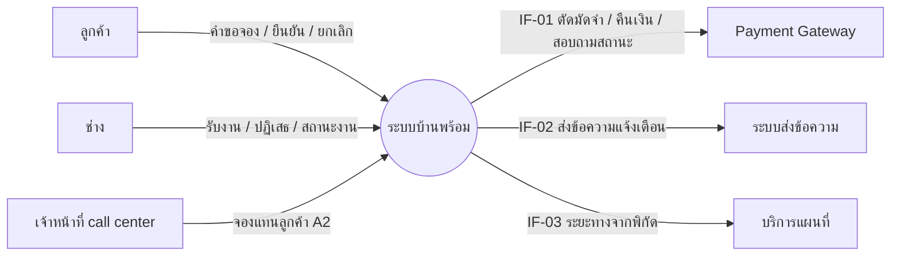
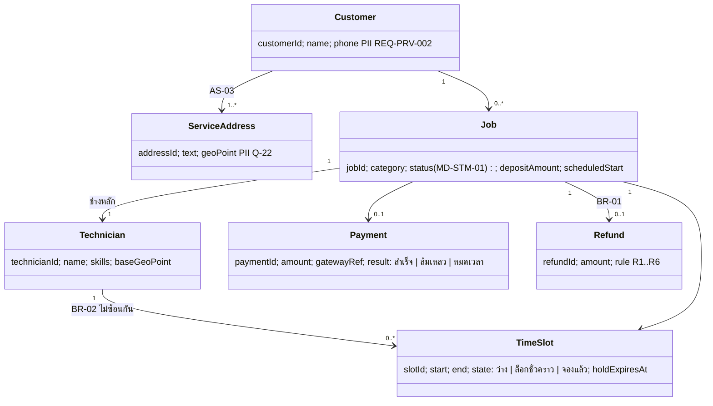
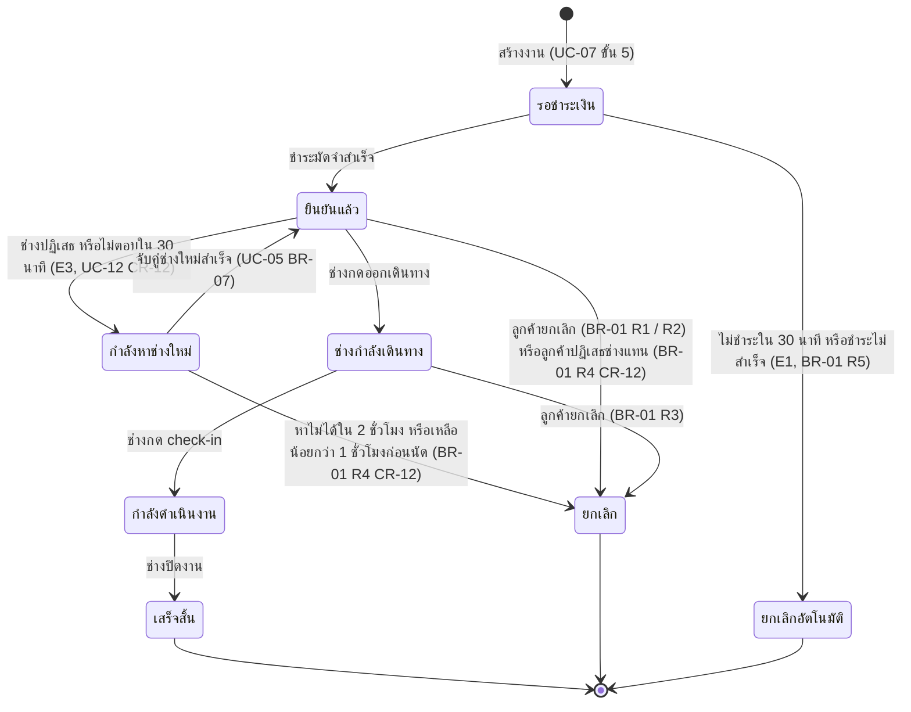
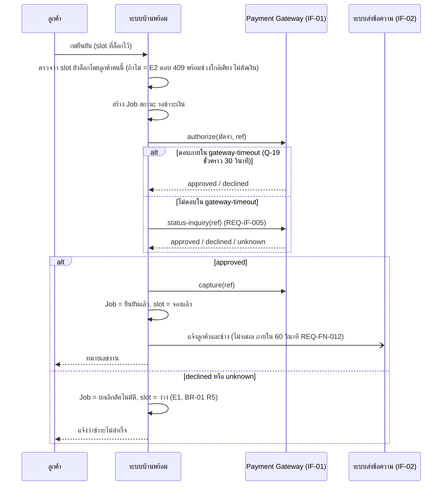

# โมเดลที่ UC-07 ใช้ (MD-CTX-01, MD-DOM-01, MD-STM-01, MD-SEQ-07-05)

เวอร์ชัน 1.0 เข้า Baseline B1 | เขียนด้วย Mermaid เปิดดูภาพได้บน GitHub
ภาพต้นฉบับขนาดเต็มอยู่ในบทเรียน Integrated Requirements Modelling

## MD-CTX-01 Context Diagram (เฉพาะส่วนที่ UC-07 แตะ)

## MD-DOM-01 Domain Model (conceptual)

## MD-STM-01 วงจรชีวิตของงาน (8 สถานะ ตาม REQ-DAT-002 ที่แก้ CC-01 แล้ว)

CR-12 (B6): ลูกศรของ E3 สร้างจริงแล้ว (specs/007-accept-rematch) "ลูกค้าปฏิเสธช่างแทน" เดิมเขียนเป็นลูกศรออกจาก "กำลังหาช่างใหม่" แต่ลูกค้าเห็นช่างแทนได้หลังงานกลับเป็น "ยืนยันแล้ว" จึงย้ายไปเป็นลูกศรออกจาก "ยืนยันแล้ว" (BR-01 R4 ไม่เปลี่ยน) "รับงาน" ของช่างไม่ใช่สถานะของงาน ดู MD-STM-04 ใน specs/007-accept-rematch/models.md Q-50 ปิด (2 ชั่วโมง)
สถานะ "กำลังดำเนินงาน" และ "เสร็จสิ้น" ยกเลิกไม่ได้ (BR-01 R6) จึงไม่มี transition "ยกเลิก" ออกจากสองสถานะนี้
CR-10 (EV-048): เดิมลูกศรสู่ "เสร็จสิ้น" เขียนว่า "ช่างปิดงาน และลูกค้ายืนยัน" Q-31 พบว่าเป็นสเปกผิด ไม่มีใครต้องการขั้นลูกค้ายืนยันใน R1 และลูกศร R3 ไม่รอ Q-14 แล้ว

## MD-SEQ-07-05 ลำดับการชำระมัดจำ (UC-07 ขั้น 5 รวม E1 และ E2)

