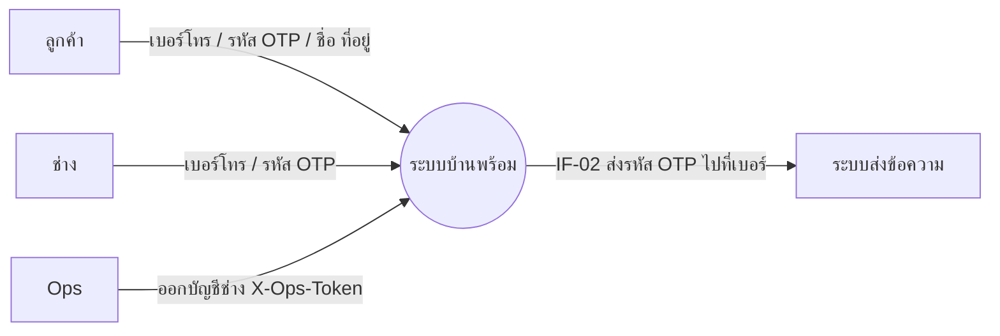
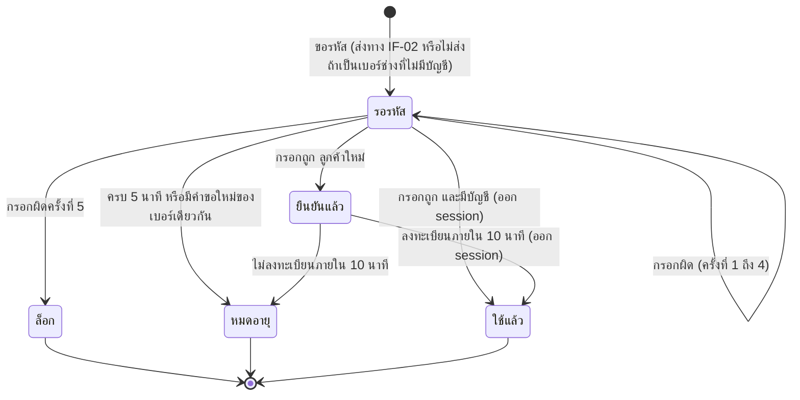
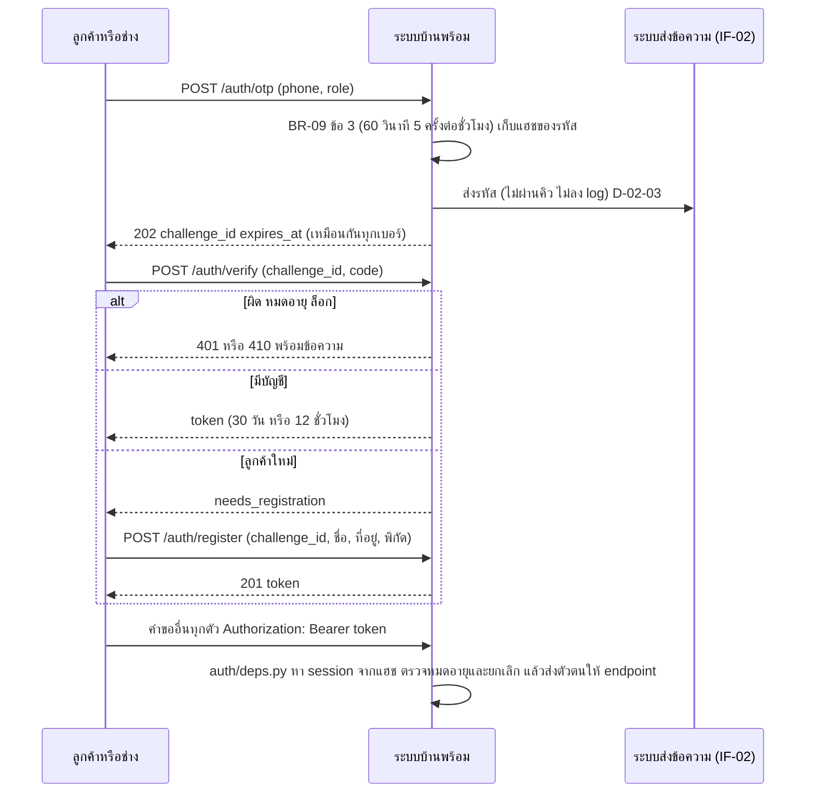

# โมเดลที่ UC-01 และ UC-02 ใช้ (MD-CTX-02, MD-STM-03, MD-SEQ-02-01)

เวอร์ชัน 1.0 เข้า Baseline B6 ตาม CR-11 | เขียนด้วย Mermaid
MD-DOM-01 เพิ่ม Account (1 ต่อ Customer หรือ Technician) AuthSession (0..* ต่อ Account) OtpChallenge (ผูกกับเบอร์ ไม่ผูกกับ Account เพราะลูกค้าใหม่ยังไม่มีบัญชี) ดู docs/srs/models.md ส่วน 6

## MD-CTX-02 Context Diagram (เฉพาะส่วนที่ UC-01 และ UC-02 แตะ)

## MD-STM-03 วงจรของคำขอ OTP 1 คำขอ

## MD-SEQ-02-01 ลำดับการเข้าสู่ระบบ (UC-02 และ UC-01 ใช้ลำดับเดียวกัน)

