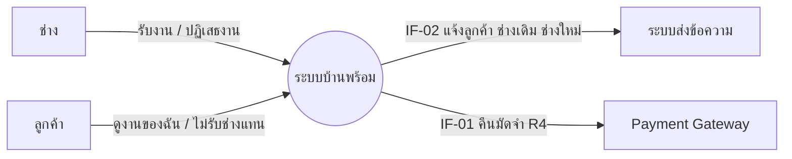
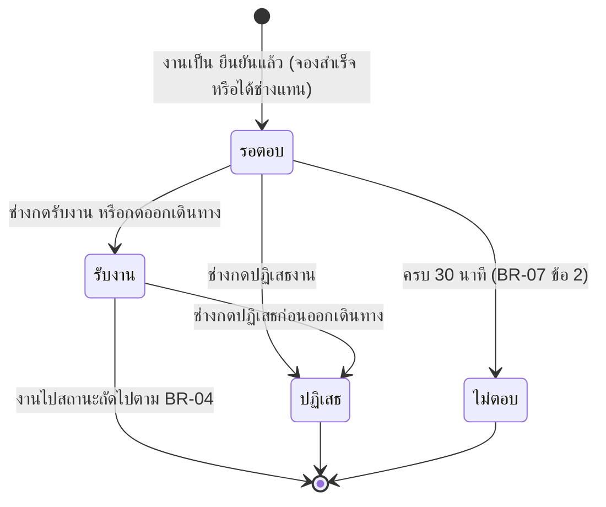
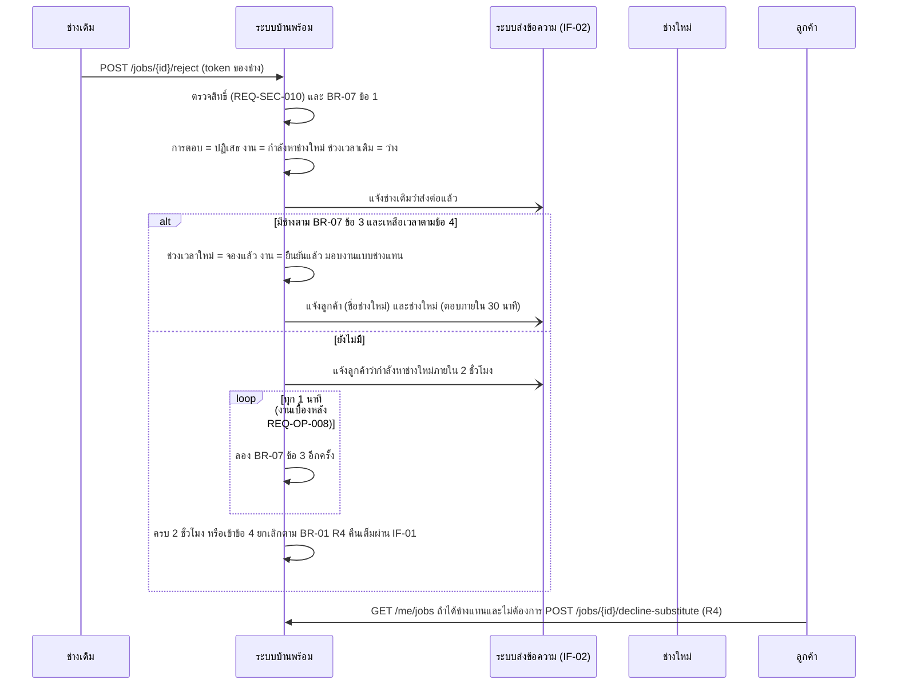

# โมเดลที่ UC-12 และ UC-05 ใช้ (MD-CTX-05, MD-STM-04, MD-SEQ-05-01)

เวอร์ชัน 1.0 เข้า Baseline B6 ตาม CR-12 | เขียนด้วย Mermaid
MD-STM-01 (วงจรชีวิตของงาน) อยู่ที่ specs/002-booking/models.md และ docs/srs/models.md ส่วน 7 ลูกศรที่ feature นี้สร้างจริงคือ
"ยืนยันแล้ว ไปยัง กำลังหาช่างใหม่" "กำลังหาช่างใหม่ ไปยัง ยืนยันแล้ว" "กำลังหาช่างใหม่ ไปยัง ยกเลิก (R4)" และ "ยืนยันแล้ว ไปยัง ยกเลิก (ลูกค้าปฏิเสธช่างแทน R4)"

## MD-CTX-05 Context Diagram (เฉพาะส่วนที่ UC-12 และ UC-05 แตะ)

## MD-STM-04 การตอบรับของช่างต่องาน 1 งาน (ไม่ใช่สถานะของงาน)

ปฏิเสธ และ ไม่ตอบ ทำให้งานไป "กำลังหาช่างใหม่" ใน MD-STM-01 ทั้งสองแบบ ช่างแต่ละคนมีแถวการตอบรับต่องานได้ครั้งเดียว (BR-07 ข้อ 3 ง)

## MD-SEQ-05-01 ช่างปฏิเสธและระบบจับคู่ช่างใหม่ (UC-12 E1 ต่อ UC-05)

