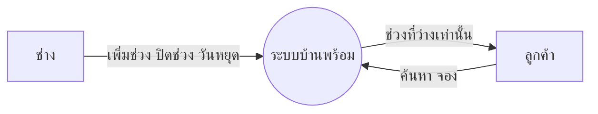
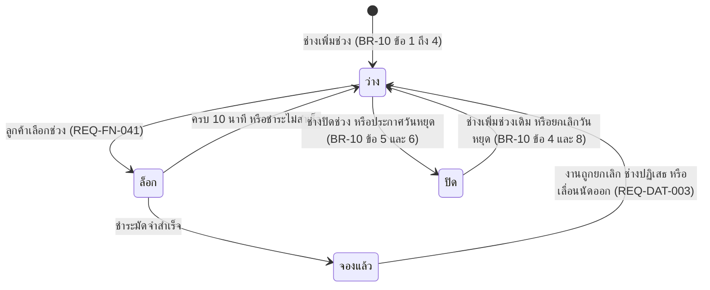
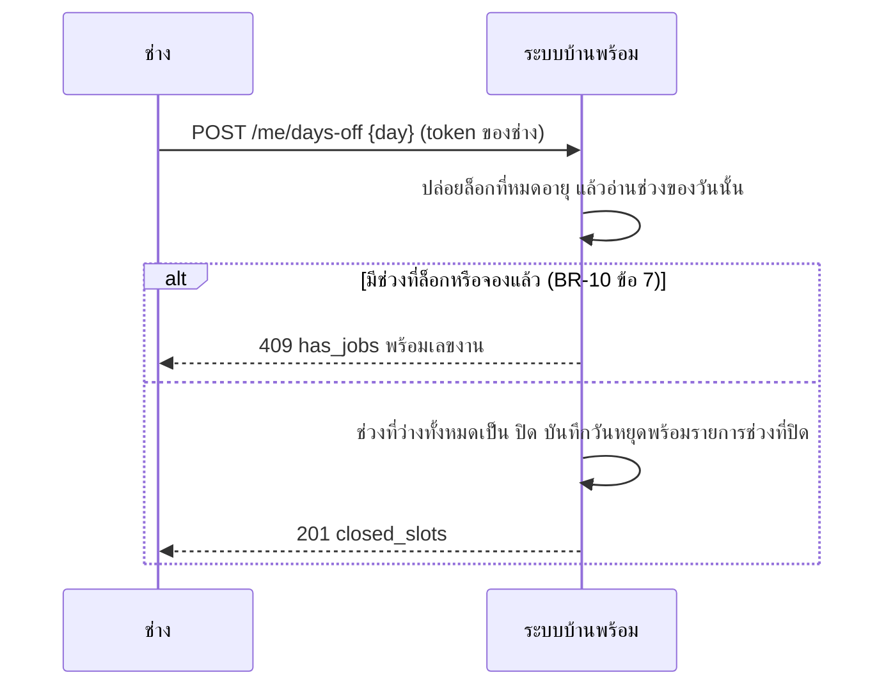

# โมเดลที่ UC-04 ใช้ (MD-CTX-04, MD-STM-05, MD-SEQ-04-01)

เวอร์ชัน 1.0 เข้า Baseline B7 ตาม CR-14 | เขียนด้วย Mermaid | MD-DOM-01 (TimeSlot, TechnicianDayOff) อยู่ที่ docs/srs/models.md ส่วน 6

## MD-CTX-04 Context Diagram (เฉพาะส่วนที่ UC-04 แตะ)

ไม่มีระบบภายนอก ตารางเวลาเป็นข้อมูลภายในทั้งหมด

## MD-STM-05 สถานะของช่วงเวลา (TimeSlot.state)

ลูกศรที่ไม่มีในภาพห้ามเกิด: ล็อก ไป ปิด และ จองแล้ว ไป ปิด (BR-10 ข้อ 5) ช่วงที่ปิดไม่ถูกลบ (D-04-01)

## MD-SEQ-04-01 ประกาศวันหยุด

