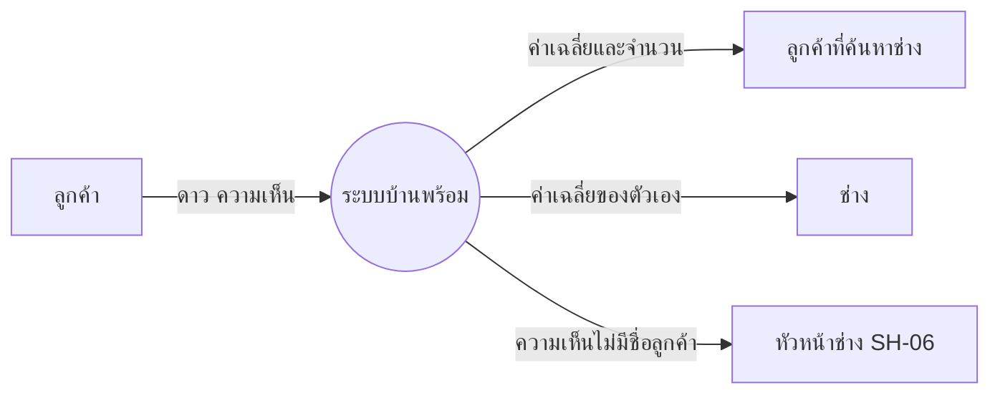
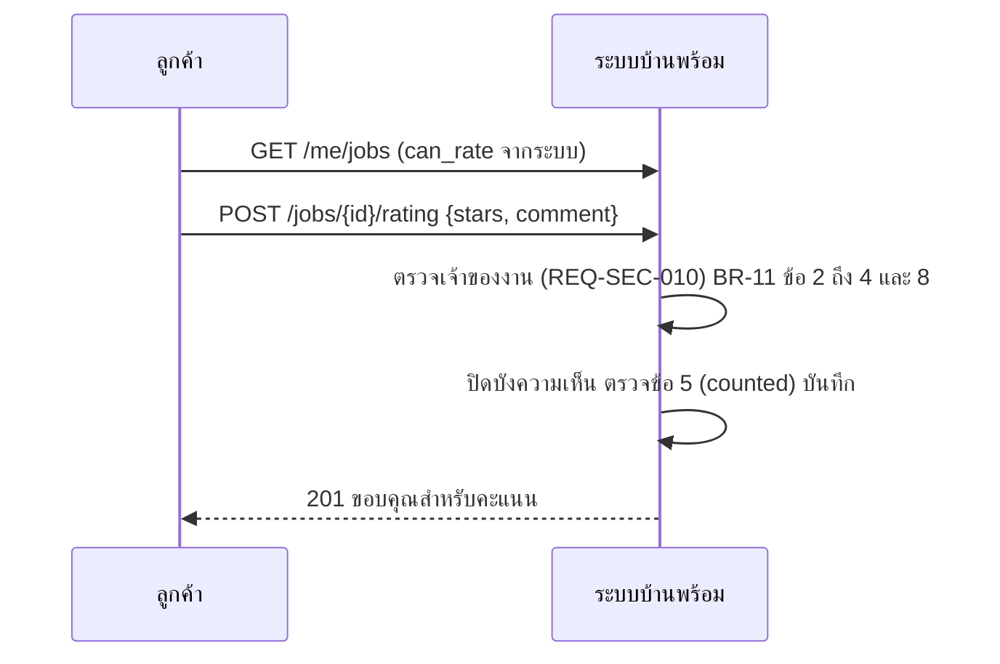

# โมเดลที่ UC-11 ใช้ (MD-CTX-11, MD-SEQ-11-01)

เวอร์ชัน 1.0 เข้า Baseline B7 ตาม CR-15 | Rating อยู่ใน MD-DOM-01 (docs/srs/models.md ส่วน 6)

## MD-CTX-11 Context Diagram

## MD-SEQ-11-01 ให้คะแนน

