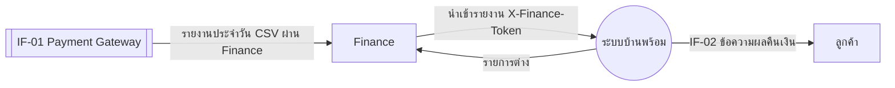
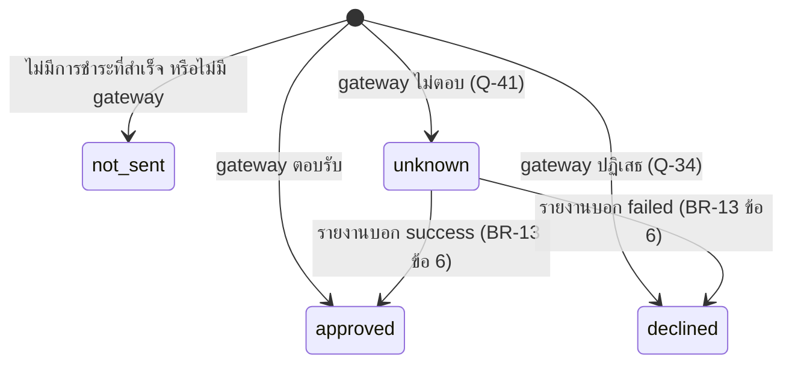

# โมเดลที่ UC-13 ใช้ (MD-CTX-13, MD-STM-06, MD-SEQ-13-01)

เวอร์ชัน 1.0 เข้า Baseline B7 ตาม CR-16 | สัญญา IF-01 ส่วน "รายงานประจำวัน" อยู่ที่ docs/srs/models.md ส่วน 9

## MD-CTX-13 Context Diagram

## MD-STM-06 ผลของการคืนเงิน (Refund.result)

declined และ unknown อยู่ในรายการติดตามของ Finance ลูกศรออกจาก approved และ declined ไม่มี (BR-13 ข้อ 7 ให้ Finance ตรวจ ไม่เปลี่ยนเอง)

## MD-SEQ-13-01 นำเข้ารายงาน

```mermaid
sequenceDiagram
  participant F as Finance
  participant S as ระบบบ้านพร้อม
  participant N as IF-02
  F->>S: POST /finance/reconciliations {report_date, csv}
  S->>S: นำเข้าไฟล์นี้แล้วหรือยัง (BR-13 ข้อ 9) ตรวจทั้งไฟล์ (ข้อ 1)
  S->>S: อ่านรายการของวันในระบบ (ข้อ 2) จับคู่ (ข้อ 3 ถึง 7)
  S->>S: unknown ที่รายงานมีผล บันทึก refund_resolutions เปลี่ยนผล
  S-)N: ข้อความถึงลูกค้า (ผ่านคิวเดิม)
  S-->>F: 201 สรุปและรายการต่าง
```

