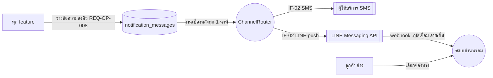
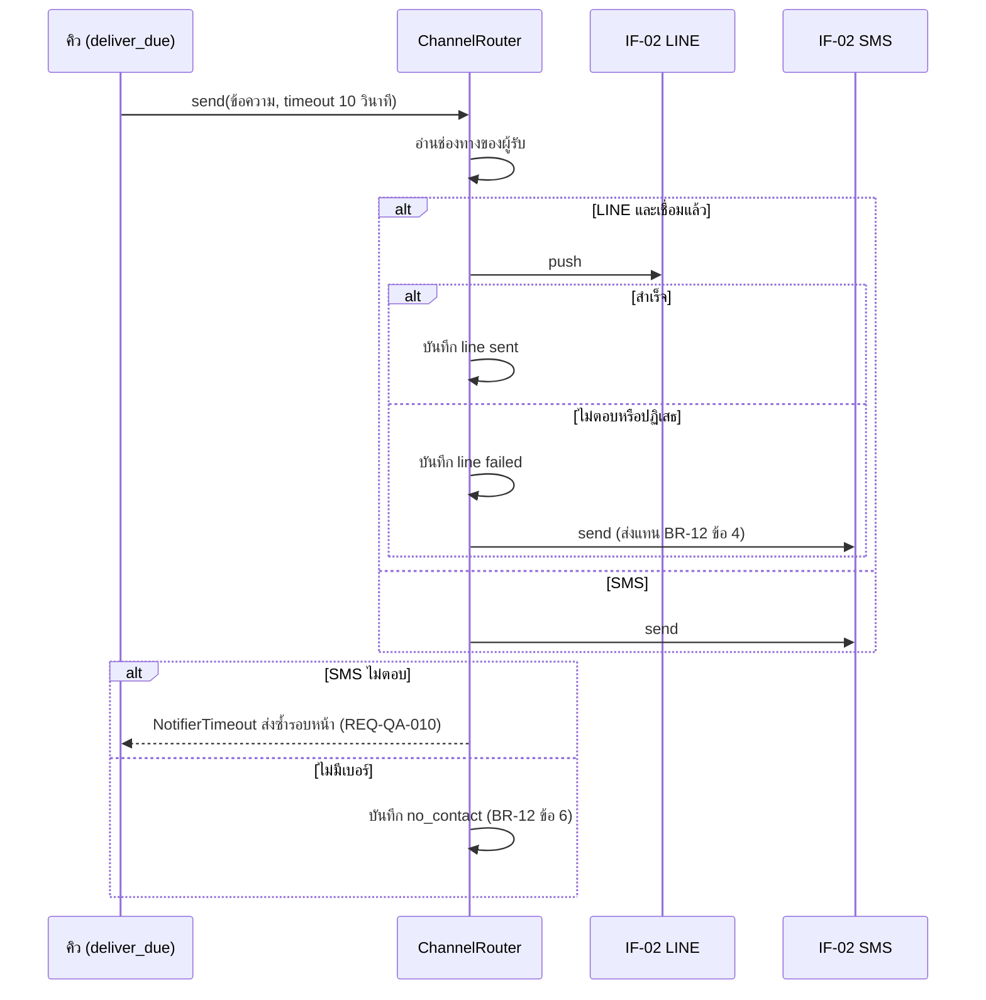

# โมเดลที่ UC-10 ใช้ (MD-CTX-10, MD-SEQ-10-01)

เวอร์ชัน 1.0 เข้า Baseline B7 ตาม CR-17 | สัญญา IF-02 (SMS และ LINE) อยู่ที่ docs/srs/models.md ส่วน 9

## MD-CTX-10 Context Diagram

## MD-SEQ-10-01 ส่งข้อความ 1 ข้อความ

